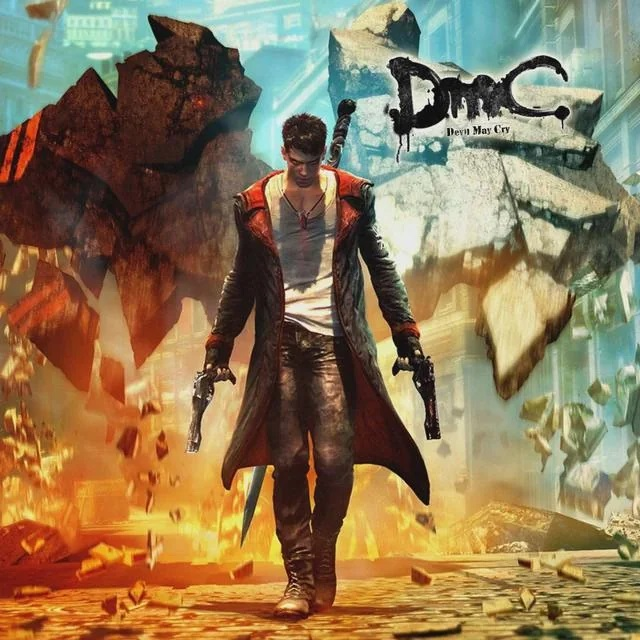

<div align=center>



</div>
<h1 align=center>DmC: Devil May Cry — Nintendo Switch port</h1>

A native Nintendo Switch port of the Xbox 360 version of **DmC: Devil May Cry** (2013, Ninja Theory / Capcom).

It's not an emulator. The PowerPC code of the game's `default.xex` (with **Title Update 1 v0.0.1.7**) and `NTJobCode.xex` is statically recompiled to C++ with [ReXGlue](https://github.com/rexglue/rexglue-sdk) and compiled natively for ARM64 on the Nintendo Switch, while Direct3D 9 / Xenos commands are rendered natively on the Switch's own graphics API, **deko3d**, via Renut's renderer (from [reNut](https://github.com/masterspike52/reNut), built on [renut_nx_ultimate_base](https://github.com/ChanseyIsTheBest/renut_nx_ultimate_base)).

> [!NOTE]
> You need your own legally obtained copy of the Xbox 360 game (`Title ID: 43430824`, `Media ID: 021BEF7B`): the extracted/unpacked disc files (`default.xex`, `Binaries/`, `DevilGame/`). **Xbox 360 Title Update 1 (`TU_11K6214_000000S000000.0000000000087`, v0.0.1.7) is REQUIRED to boot this port AND is REQUIRED if you want to install and play any DLC.** DLC packages are optional (and require Title Update 1). This repository and release package contain no original game assets, `.xexp` updates, or copyrighted binaries.

---

## How to install

1. Download **`dmc_devil-nx-v1.0.0.zip`** from [Releases](https://github.com/BanhMi93P/dmc_devil-nx/releases) and extract it to the root of your Switch SD card (`sdmc:/`), creating `sdmc:/switch/dmc_devil/`.
2. Copy your unpacked Xbox 360 base game files (`default.xex`, `Binaries/`, `DevilGame/`, etc.) into `sdmc:/switch/dmc_devil/game/` (both `game/` and `game_root/` are supported).
3. **(Required) Install Title Update 1:** Copy your raw Xbox 360 Title Update 1 STFS file (`TU_11K6214_000000S000000.0000000000087`) into `sdmc:/switch/dmc_devil/Update/`. **Title Update 1 is required to boot the port and required to install/use any DLC.**
4. *(Optional)* To use Xbox 360 DLCs with your game (**requires Title Update 1**), place the raw DLC STFS packages in `sdmc:/switch/dmc_devil/dlc/` (see [Title Update 1 & Optional DLC (Automatic Installer)](#title-update-1--optional-dlc-automatic-installer)).

Your `dmc_devil` folder on the SD card should look like this:

```text
/switch/dmc_devil/
  dmc_devil.nro
  dmc_devil.toml            (runtime configuration)
  deko3d_glsl.bin           (35,734 translated deko3d GLSL shaders)
  deko3d_shaders.bin        (36,878 precompiled Maxwell DKSH shader variants)
  deko3d_shaders.bin.idx    (BDKI index for deko3d_shaders.bin)
  game/                     (unpacked files from your Xbox 360 disc; game_root/ also supported)
    default.xex
    Binaries/
    DevilGame/
  Update/                   (REQUIRED: place raw TU_11K6214_000000S000000.0000000000087 here)
  dlc/                      (optional: drop Xbox 360 DLC STFS packages here — requires Title Update 1)
```

> [!IMPORTANT]
> **39-bit Forwarder / Title Override Required:** Launch the game using **Title Override** (hold **R** while starting any installed Switch game) or an NSP forwarder configured with a **39-bit address space** (e.g. made with [Sphaira](https://github.com/NaGaa95/sphaira)). **Album applet mode does not provide enough memory and will fail to boot.**

> [!TIP]
> The release package ships with a complete offline shader cache covering **35,734** translated UE3 Xenos shaders (`deko3d_glsl.bin`) and **36,878** precompiled Maxwell GPU DKSH variants (`deko3d_shaders.bin` + `deko3d_shaders.bin.idx`, scanned across Base, Title Update 1, and all 5 DLCs), eliminating first-run shader compilation stutter. Any new pipeline variant encountered during gameplay is automatically saved to `deko3d_shaders.bin` on the SD card.

---

## Title Update 1 & Optional DLC (Automatic Installer)

> [!IMPORTANT]
> **Title Update 1 Required for Boot & DLC:** This build is statically recompiled against **Title Update 1 (`v0.0.1.7`)**. **If you want to install and play DLC (Vergil's Downfall, Bloody Palace, Weapon Packs), you MUST install Title Update 1 (`TU_11K6214_000000S000000.0000000000087`)** — without Title Update 1, the base `1.0` executable does not recognize the DLCs and this build will display an on-screen missing-update guide instead of booting.

Both **Title Update 1** and **DLC packs** (*Vergil's Downfall*, *Bloody Palace*, *Samurai / Gold / Bone Weapon Packs*) use the built-in startup STFS installer:

1. Copy your raw Xbox 360 Title Update 1 file (`TU_11K6214_000000S000000.0000000000087`) into `sdmc:/switch/dmc_devil/Update/`.
2. *(Optional)* Copy any raw Xbox 360 DLC STFS container files into `sdmc:/switch/dmc_devil/dlc/` (leave empty to boot directly after TU1 is installed).
3. Launch `dmc_devil.nro`:
   - On launch, when raw packages are detected in `Update/` or `dlc/`, a full-screen installer UI appears with a real-time **`%` progress bar**, live per-package & total MB progress details, and a hint showing how to open the Settings / Debug Menu (`+` + `−`).
   - **Title Update 1** is extracted first into `sdmc:/switch/dmc_devil/Update/` (`default.xexp`, `Binaries/NTJobCode/xenon/submission/NTJobCode.xexp`, and 4 `.xxx` files).
   - **DLC packages** are extracted cleanly into `sdmc:/switch/dmc_devil/renut/0000000000000000/43430824/00000002/` alongside their `.header` metadata files with full license unlock (`license_mask = 4294967295`).
   - Once each package is verified, the **raw source file in `Update/` and `dlc/` is automatically deleted** to save SD card space, and subsequent launches skip the installer automatically.

**Startup Splash:** Before booting into the game, the port displays a 3-second startup splash screen (`intro.png`).

---

## Verified File Sizes & Checksums

Use the tables below to verify that your release files and unpacked Xbox 360 inputs match the tested build.

### Release Distribution Files (`switch/dmc_devil/`)

<div align="center">

| File | Size | SHA-256 | MD5 |
| --- | --- | --- | --- |
| `dmc_devil.nro` | `111,442,147 B` (`106.28 MiB`) | `be4d428c033f4ad5b6bcd405ba220be90ff5bc20776c17ee9b301bf7ff26ccab` | `997a9298229275a9c151e72c322a52f3` |
| `dmc_devil.toml` | `1,832 B` | `82a1d151ccc8cc87515d3e99bfd34960a37dc7d8a920f48a95b22c7ae4f676d6` | `f15034eea2221682a92b27a0a49bb175` |
| `deko3d_glsl.bin` | `88,284,064 B` (`84.19 MiB`) | `3ed9858a7830b3dfd998493daf5625543afdcddaf9e102364f4d66977339fa55` | `9b15908873acb2d260623f050ce8b0da` |
| `deko3d_shaders.bin` | `312,742,592 B` (`298.25 MiB`) | `3adc76dbb999d14c2d05cda139500c085bac33399385c294192e861548235865` | `c111a199096addccf929387875be7dc0` |
| `deko3d_shaders.bin.idx` | `885,112 B` (`0.84 MiB`) | `5825f358f7743a177598a6e5318a32e8f0b09e74936fd9f6cfa3d5a2eeba020a` | `7759e355ffbaf6f42f7b7bf52864ae96` |

</div>

### Tested Base Game Executables (`game/`)

<div align="center">

| File | Title ID | Size | SHA-256 | MD5 |
| --- | --- | --- | --- | --- |
| `default.xex` | `43430824` | `23,805,952 B` (`22.70 MiB`) | `1ebc61bb4d8c8d2ed405a688bdf5f8325e14721a306762bf0964fc9ee8527d2d` | `9f8e387abca41b16a9c17c1605cbf2fd` |
| `Binaries/NTJobCode/xenon/submission/NTJobCode.xex` | `43430824` | `167,936 B` (`0.16 MiB`) | `35eb2e2fe2148de73777de93d7ff6da406ccd0145752aaae88506f45eeffd644` | `9cca1ea5265d90dee23fc5d305a98936` |

</div>

### Tested Required Title Update (`Update/`)

<div align="center">

| File Name | Content Name | Size | SHA-256 | MD5 |
| --- | --- | --- | --- | --- |
| `Update/TU_11K6214_000000S000000.0000000000087` | DmC Devil May Cry Title Update (v0.0.1.7) | `3,035,136 B` (`2.89 MiB`) | `533db3ebf050859966f1ee53870278822089a33d04c30829b004b09921fb93da` | `f114fb0b3f3b0ba0ec176237533b7757` |

</div>

### Tested Optional DLC (`dlc/`) Packages

<div align="center">

| File Name | Content Name | Size | SHA-256 | MD5 |
| --- | --- | --- | --- | --- |
| `dlc/8F7A42E2131C53CFBF1BD17B49BA3D4A181C3C9143` | Vergil Premium DLC (*Vergil's Downfall*) | `1,994,964,992 B` (`1,902.55 MiB`) | `3a2a6a3a5cc1ce52ad94d30233d523de2f8beef11fb21ec37fed18f378f5470e` | `6484cb9233cf372cba13607e543a9080` |
| `dlc/C25FEE1EA29C864D29763B88921736110A5A3F6E43` | Bloody Palace DLC | `211,169,280 B` (`201.39 MiB`) | `437c0459a1f5993601fbba4222787acb207c24585d0407233fb492f2eed6f16d` | `a42599676140c03b26c5a39f45e705d7` |
| `dlc/12BEB55723285BE40F9BBB77E753E3C725310FCE43` | Samurai Weapon Pack | `3,543,040 B` (`3.38 MiB`) | `0a557a5451cd098c94072f00abb4e16e6ef96cdd4f688707b34c949cf7d18ea8` | `a7d023bf966582f40c7d477f008db9d8` |
| `dlc/38ADB7CEF5C7EB8CB12C9617FD0836B39C3B488043` | Gold Weapon Pack | `3,190,784 B` (`3.04 MiB`) | `81e0803b1e8c1be3cd42092f2a62fc3b34cef44fc534649d230a0b7e7227567d` | `181fa043f0e1fa7f614741fe1290676e` |
| `dlc/C5952365F1BECD3B62F021B080605472095A82C943` | Bone Weapon Pack | `4,149,248 B` (`3.96 MiB`) | `dd41099789430942ce2dc3afecee3bd2d40fc5a479ecd4e5d34373e5c5a4b17a` | `6bf826603a5cd6999d117ed1d92cd436` |

</div>

---

## Controls

By default (`input_xbox_layout = false`), face buttons follow Nintendo Switch letter positions, and `input_xbox_layout = true` maps them by physical Xbox controller position:

<div align="center">

| Switch Physical Button | Xbox 360 (`input_xbox_layout = false`) | Xbox 360 (`input_xbox_layout = true`) |
| --- | --- | --- |
| **A** (right) | **A** | **B** |
| **B** (bottom) | **B** | **A** |
| **X** (top) | **X** | **Y** |
| **Y** (left) | **Y** | **X** |
| **R / L** | **RB / LB** | **RB / LB** |
| **ZR / ZL** | **RT / LT** | **RT / LT** |
| **+** / **−** | **Start** / **Back** | **Start** / **Back** |
| **+ and − together** | Open / Close Settings & Debug Menu | Open / Close Settings & Debug Menu |

</div>

---

## In-Game Settings & Debug Menu

Press **`+` and `−` together** at any time during gameplay (or touch screen navigation) to open the **Settings & Debug Menu**. Game input is automatically blocked while the menu is open, and any changes you make are saved back to `dmc_devil.toml`.

- **Navigation:** `D-Pad / Left Stick` = Select option, `Left / Right` or `A` = Change value, `L / R` = Switch tabs (`Settings`, `Achievements`, `P1–P4 Controls`), `+` = Save & Close.
- **Available In-Game Options & Debug Tools:**
  - **Handheld / Docked Resolution:** Live switch between `480p (853x480)`, `540p (960x540)`, and `720p (1280x720)` (default: `720p`).
  - **Dynamic Resolution (`banjo_renut_dynamic_resolution`):** Automatically scales internal resolution (`480p`–`720p` handheld) based on GPU frame time to help hold **30 FPS**.
  - **VSync (`renut_vsync`):** Toggle presentation VSync live (default: `Off`).
  - **SMAA / MSAA (`banjo_renut_smaa` / `msaa_level`):** Toggle SMAA 1x (across 96 DmC post-tonemap pixel shaders, default `Off`) and MSAA (`1x`, `2x`, `4x`, default `1x`).
  - **Environment Shadows (`dmc_env_shadows`):** Adjust environment shadow map resolution (`1.0x`, `0.75x`, `0.67x`, `0.5x`, `Off`; default: `0.67x`).
  - **Character Shadows (`dmc_char_shadows`):** Adjust character / NPC shadow map resolution (`1.0x`, `0.75x`, `0.67x`, `0.5x`, `Off`; default: `0.67x`).
  - **Show FPS (`banjo_show_fps`) & Show Profiler (`banjo_show_profiler`):** Toggle the live FPS counter and CPU/GPU frame-pacing graph overlay (both `Off` by default).
  - **Capture Frame Diag:** Closes the menu and writes a 1-frame GPU draw/shader/texture/EDRAM diagnostic log to `logs/frame_diag_NNN.log`.
  - **Framerate Cap / 4-Core Mode / Controls Remapping / UI Theme & Opacity.**

<details>
<summary><b>Default Release Settings in <code>dmc_devil.toml</code></b></summary>

| Setting | Release Default | Description |
| --- | --- | --- |
| `renut_resolution` / `banjo_renut_render_height_handheld` / `_docked` | `"720p"` / `720` | Internal rendering resolution (`480p`, `540p`, or `720p`) |
| `banjo_renut_dynamic_resolution` | `false` | Fixed `720p` by default; enable live in `+` + `−` menu for steadier 30 FPS |
| `renut_vsync` | `false` | VSync disabled by default to avoid 20 FPS step-down |
| `banjo_renut_smaa` / `msaa_level` | `false` / `1` | Anti-aliasing off by default for Switch GPU headroom |
| `dmc_env_shadows` / `dmc_char_shadows` | `"0.67x"` / `"0.67x"` | 0.67× environment and character/NPC shadow resolution |
| `banjo_show_fps` / `banjo_show_profiler` | `false` | Performance monitors disabled in release for zero overhead |
| `log_level` / `log_file_writer` | `"warn"` / `false` | File logging disabled in release for maximum I/O & CPU performance |
| `input_menu_combo` | `"PLUS+MINUS"` | Button combo to open the in-game Settings / Debug menu |

</details>

---

## Performance, Resolution & Overclocking

- **Recommended Setup for Stable 30 FPS:**
  - Turn **Dynamic Resolution ON** (in the `+` + `−` menu or set `banjo_renut_dynamic_resolution = true` / `banjo_renut_dynamic_resolution_handheld = true` in `dmc_devil.toml`).
  - Overclock **CPU to `1224 MHz`** and **GPU to `537 MHz`** (via `sys-clk` or `Horizon OC`) for a smooth, stable **30 FPS** experience across both the Base campaign and *Vergil's Downfall* DLC.
- **Stock Clocks (`1020 MHz` CPU / `460.8 MHz` GPU handheld):**
  - Turn **Dynamic Resolution ON** (or drop resolution to `540p`/`480p`) and lower or disable **Environment Shadows** and **Character Shadows** (`0.5x` or `Off`) in the `+` + `−` menu to maximize FPS without raising clocks.
- **Scene Transitions Note:**
  - Brief FPS dips can occur momentarily during heavy combat effects or area streaming transitions before stabilizing back to normal speed.

> [!CAUTION]
> Overclocking pushes the console beyond what it was designed for and you do it at your own risk. Always monitor temperatures and keep a backup before modifying system clocks.

Community guides:
- **[How to get 60 FPS](https://rentry.org/howtoget60fps)**: tools and setup (Horizon OC, Ultrahand, Status Monitor).
- **[Mariko guide](https://rentry.co/mariko)**: Switch V2, Lite, and OLED.
- **[Erista guide](https://rentry.co/erista)**: original 2017 Switch.

---

## How it works

- **Static recompilation, not emulation.** [ReXGlue](https://github.com/rexglue/rexglue-sdk) translates PowerPC functions from TU1 `default.xex` (`0.0.1.7`) and static-linked `NTJobCode.xex` to C++, compiled directly to AArch64 machine code with LTO, `renut_NTJobCode` store-card tracking for `FMorphVertexBuffer` / `CPUSkinningJob`, and serialized Wwise audio callbacks (`dmc_wwise_fix.cpp`).
- **Native deko3d UE3 renderer.** Xbox 360 D3D9 command streams execute natively on the Switch Maxwell GPU via Renut's renderer and [plume](https://github.com/renderbag/plume)'s deko3d backend, featuring UE3 Xenos `7e3` `R11G11B10_FLOAT` HDR targets, hardware sRGB texture views (`dmc_gpu_hw_srgb`), compute `FCombineLUTs` stacked LUT resolve, Maxwell tile binning, lazy depth/stencil EDRAM handovers, Core 3 GPU helper unlock (`banjo_system_core = 2`), and live resolution/shadow scaling.
- **Prebuilt 36.8k shader variant cache.** **35,734** translated UE3 Xenos GLSL shaders (`deko3d_glsl.bin`) and **36,878** precompiled Maxwell DKSH binaries (`deko3d_shaders.bin` + `.idx`) prevent in-game shader stutter.
- **Built-in Switch UX.** Embedded STFS Title Update & DLC auto-installer (`dmc_startup_overlay.cpp`) with live `%` / MB progress, missing-update guard screen, automatic cleanup of raw packages, 3-second startup splash, UTF-8 NACP metadata, and live `+` + `−` Settings & Debug Menu.

---

## Build

Requires Windows, LLVM/Clang and Visual Studio Build Tools for host tooling; devkitA64, libnx, and deko3d from [devkitPro](https://devkitpro.org) for the Switch target; Python 3; and your own legally dumped Xbox 360 copy of *DmC: Devil May Cry* + Title Update 1.

<div align="center">

| Folder | Contents |
| --- | --- |
| `app/` | Game layer (`dmc_startup_overlay.cpp`, `dmc_wwise_fix.cpp`, `game_menu.cpp`), D3D9 hooks, Renut deko3d renderer (`app/src/renut_engine/gpu`), CMake project |
| `sdk/` | ReXGlue SDK with Nintendo Switch Horizon OS layer, XMA/Wwise audio, XEX patch (`update:`) & STFS/VFS support, ImGui/JPEG UI |
| `tools/` | Post-codegen store-card & optimization scripts, UE3 shader scanners, GLSL/DKSH variant cache builders |
| `dist/` | Default Switch runtime configuration (`dist/switch/dmc_devil/dmc_devil.toml`) |
| `docs/` | Technical documentation and porting notes (`docs/dmc_devil-notes.md`) |

</div>

---

## Credits

- **Ninja Theory and Capcom** — creators of *DmC: Devil May Cry* (2013). This is an unofficial, fan-made port with no affiliation.
- **[BanhMi93P](https://github.com/BanhMi93P)** — *DmC: Devil May Cry* Nintendo Switch port (`dmc_devil-nx`), TU1 `0.0.1.7` port & D3D9 hook migration, `NTJobCode` store-card & Wwise audio fixes, UE3 deko3d HDR/sRGB/EDRAM/shadow optimizations, 36,878 DKSH shader cache, built-in TU1/DLC installer & startup splash.
- **[ChanseyIsTheBest](https://github.com/ChanseyIsTheBest/renut_nx_ultimate_base)** — `renut_nx_ultimate_base` and sibling Xbox 360 Switch ports.
- **[Tom Clay](https://github.com/rexglue/rexglue-sdk)** — the ReXGlue SDK, built on **[Xenia](https://xenia.jp)**.
- **[masterspike52](https://github.com/masterspike52/reNut)** — reNut's Direct3D-level renderer.
- **[StevensND](https://github.com/StevensND/nfsmw-nx)** — `nfsmw-nx` Switch SDK layer & profiling tools.
- **[hedge-dev](https://github.com/hedge-dev/XenosRecomp)** — XenosRecomp; **[renderbag](https://github.com/renderbag/plume)** — plume; **[fincs](https://github.com/devkitPro/deko3d)** — deko3d and [uam](https://github.com/devkitPro/uam).
- **[devkitPro](https://devkitpro.org) and [switchbrew](https://github.com/switchbrew/libnx)** — devkitA64 and libnx.
- Additional third-party libraries listed in [THIRD_PARTY_NOTICES.md](THIRD_PARTY_NOTICES.md).

---

## Legal

No affiliation with Capcom, Ninja Theory, Microsoft, or Nintendo. "DmC: Devil May Cry" is a trademark of Capcom Co., Ltd. This repository contains no assets or program code from the original game. Users must provide their own legally obtained copy of the Xbox 360 game and Title Update 1. Running homebrew requires custom firmware — proceed at your own risk.

Source code is provided under the GPL-3.0 License (see [LICENSE](LICENSE)). The SDK retains its BSD-3-Clause license (see [THIRD_PARTY_NOTICES.md](THIRD_PARTY_NOTICES.md)).
